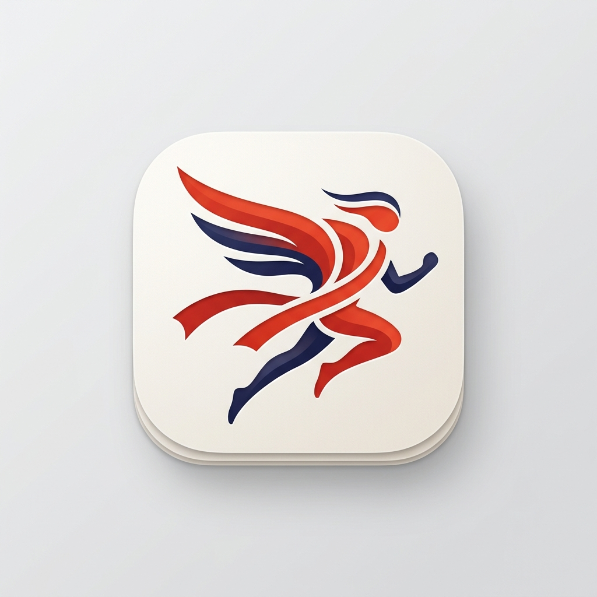

# KazeRun (风走)

<p align="center">
  
</p>

<p align="center">
  <strong>专为跑步者打造的现代原生 macOS 跑步看板与训练分析中心</strong><br>
  A high-aesthetic, native macOS running telemetry dashboard designed for Garmin Connect runners.
</p>

<p align="center">
  
  
  
  
  
</p>

---

## ✨ 核心特性

- 🏃 **今日状态与身体准备就绪度 (Today & Readiness)**
  - **夜间 HRV 连续时序图谱**：绘制夜间 5 分钟高频采样曲线、基线均衡带（87–120ms）与均值参考线，支持鼠标划动采样吸附。
  - **睡眠分期与质量评估**：深睡、浅睡、REM 快速眼动与清醒时长可视化，附带睡眠质量评分。
  - **静息心率与身体电量**：充放电曲线追踪与 7 日 RHR 恢复演变。
  - **月度负荷平衡靶位量表**：立体的低有氧 / 高有氧 / 无氧三维负荷平衡量表，以高辨识度球门靶位与游标指示，未达标自动连线引导。

- 📈 **长期恢复与能力演变 (Trends)**
  - **HRV 恢复趋势**：30 天/90 天夜间均值与 7 日移动滚动均线，智能自适应 Y 轴动态区间。
  - **VO2Max 演变曲线**：最大摄氧量阶段演变，与 HRV 共享像素级垂直对齐的统一时间轴与网格。

- 🗺️ **活动明细与高精轨迹 (Activity Detail & Telemetry)**
  - **高精度地图回放**：基于 MapKit 绘制跑步路线，支持暗色/亮色自适应与轨迹吸附。
  - **心率区间与分段圈段**：Z1–Z5 五段心率分布占比图、全圈段配速/步频/爬升明细表。
  - **跑鞋装备直接同步**：直接关联与管理 Garmin 云端跑鞋资产，本地一键绑定/移除。

- 🌡️ **气象与跑步热应激科学解算 (Dew Point Metric)**
  - 基于国际气象学标准 **Magnus-Tetens 公式** 由实测气温与相对湿度实时解算**露点（Dew Point）**，直观量化跑步出汗散热受阻程度。
  - 露点全热区交互展开：鼠标悬停即平滑浮出实测气温与相对湿度读数，客观量化，无任何粗糙定性词汇。

- 🔒 **本地私密优先 (Privacy First)**
  - 用户的 Garmin 登录凭证（OAuth Tokens）与离线缓存仅安全保存在本地 macOS 用户专属的 `Application Support` 目录，绝不上传至任何第三方服务器。

- 🌏 **双区与双语体系**
  - 原生支持 **Garmin 中国区（佳明）** 与 **Garmin 国际区（Global）** 一键切换。
  - 完整内建中文（简体）与日文（日本語）双语界面。

---

## 🏗️ 架构设计

KazeRun 采用纯原生客户端配合异步轻量 Python Sidecar 的解耦架构：

```
+-------------------------------------------------------------+
|                     KazeRun (SwiftUI)                       |
|   macOS 14+ / Swift Charts / MapKit / Observation Framework |
+-------------------------------------------------------------+
                             ▲
                             │ JSON-RPC (stdin / stdout)
                             ▼
+-------------------------------------------------------------+
|               Sidecar Bridge (Python 3.10+)                 |
|       garminconnect (OAuth2 / MFA) + garmin-mcp             |
+-------------------------------------------------------------+
                             ▲
                             │ HTTPS (TLS)
                             ▼
+-------------------------------------------------------------+
|             Garmin Connect API (CN / Global)                |
+-------------------------------------------------------------+
```

---

## 🚀 快速上手与运行

### 1. 环境准备
- **操作系统**：macOS 14.0 (Sonoma) 或更高版本
- **开发工具**：Xcode 15.0+ 或 Swift 5.9+ 工具链
- **Python 环境**：Python 3.10+（推荐通过 Homebrew 安装：`brew install python@3.12`）

### 2. 克隆项目
```bash
git clone https://github.com/your-username/KazeRun.git
cd KazeRun
```

### 3. 安装 Python 桥接依赖
项目自带一键配置脚本：
```bash
./scripts/setup_env.sh
```
*或者手动创建并安装：*
```bash
python3 -m venv bridge/.venv
./bridge/.venv/bin/pip install -r bridge/requirements.txt
```

### 4. 编译与运行
- **直接命令行运行**：
  ```bash
  swift run
  ```
- **打包为独立 macOS App 包 (`dist/KazeRun.app`)**：
  ```bash
  ./scripts/build_app.sh
  open dist/KazeRun.app
  ```

---

## ⚙️ 环境变量选项（可选高级配置）

| 变量名 | 说明 |
| :--- | :--- |
| `KAZERUN_DATA_DIR` | 自定义用户配置与 Token 存储目录（默认：`~/Library/Application Support/KazeRun`） |
| `KAZERUN_PYTHON` | 手动指定使用的 Python 解释器绝对路径 |
| `GARMIN_MCP_SRC` | 本地自建或开发态 `garmin-mcp` 源码目录路径 |

---

## 🤝 协作与维护规范

本项目由开发者与 AI 协同演进：
- [项目维护规范 (AGENTS.md)](AGENTS.md)：开发与改动前必读。
- [完整更新日志 (CHANGELOG.md)](CHANGELOG.md)：详实记录历史改动、架构演进与验证状态。

---

## 📜 免责声明 (Disclaimer)

KazeRun 是一个独立的开源个人跑步分析项目，与 **Garmin Ltd.** 或其任何附属子公司不存在官方关联，亦未获得其赞助或认可。Garmin、Garmin Connect 均为 Garmin Ltd. 的注册商标。

---

## 📄 开源许可证

本项目基于 [MIT License](LICENSE) 许可协议开源。
